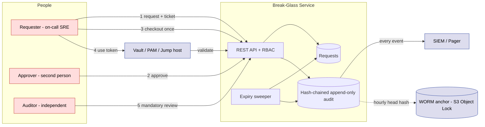
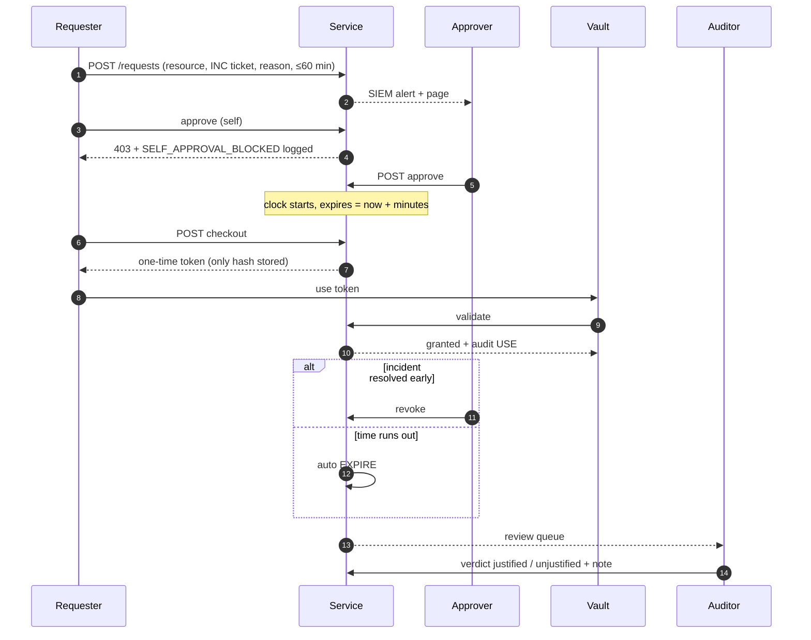
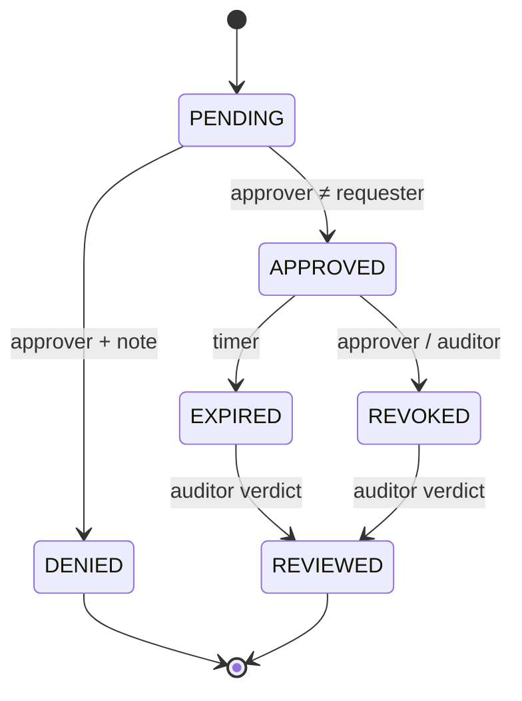
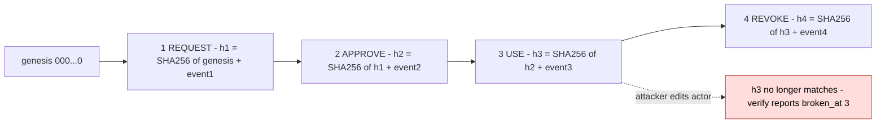

# 🔴 Break-Glass: Emergency Access with Tamper-Evident Audit Trail

**The problem:** at 3 a.m. production is down, SSO is broken or the only person with root is asleep. Someone must get privileged access *now*, yet regulators (SOX, PCI DSS, FFIEC, FedRAMP, HIPAA) require that every emergency grant is justified, approved by a second person, time-limited, fully logged and reviewed afterwards. Most firms do this with a shared password in a safe and a spreadsheet. This repo is a working implementation.

```bash
# Windows without make: python scripts/demo.py | python app/breakglass.py | python -m unittest -v tests/test_breakglass.py
make demo     # watch a full P1 incident + an attack on the audit log, in your terminal
make run      # live console at http://localhost:8080  (or: make up for Docker)
make test     # 5 tests proving the controls
```
Zero dependencies. Python 3.9+ standard library only.

## Architecture


## Incident lifecycle


## State machine


## Tamper-evident audit log
Each row's hash covers the previous hash, so editing any row breaks every row after it. SQL triggers block `UPDATE`/`DELETE`; the chain catches anyone who bypasses the triggers (`make demo` shows exactly that).


## Threat model
| Threat | Mitigation |
|---|---|
| Insider approves own request | Dual-control check, attempt itself is logged |
| Token stolen/replayed | One-time checkout, hash-only storage, expiry, revoke |
| Standing access creeping in | Hard 60-min cap, auto-expiry |
| Admin edits log to hide misuse | Triggers + hash chain; production: external anchor (see docs/CONTROLS.md) |
| Nobody reviews afterwards | Every revoke/expiry opens a review item |
| Fake "emergencies" | Ticket pattern + reason required, every request alerts |

## API
`POST /requests` · `GET /requests` · `POST /requests/{id}/approve|deny|checkout|revoke|review` · `POST /vault/use` (header `X-Break-Glass-Token`) · `GET /audit` · `GET /audit/verify` · `GET /reviews/pending`
Demo personas (Bearer tokens): `t-alice` requester, `t-bob`/`t-carol` approvers, `t-dave` auditor.

See [docs/CONTROLS.md](docs/CONTROLS.md) for the compliance mapping and production hardening checklist.
